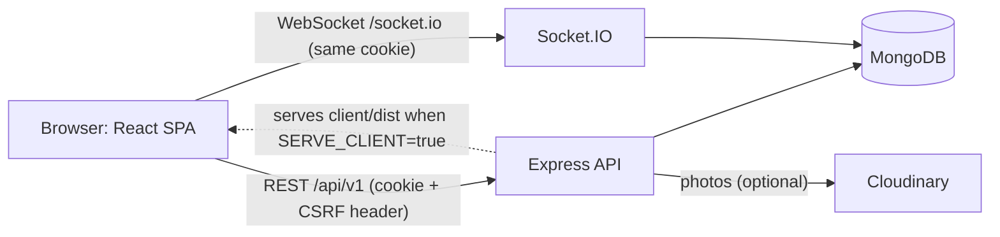
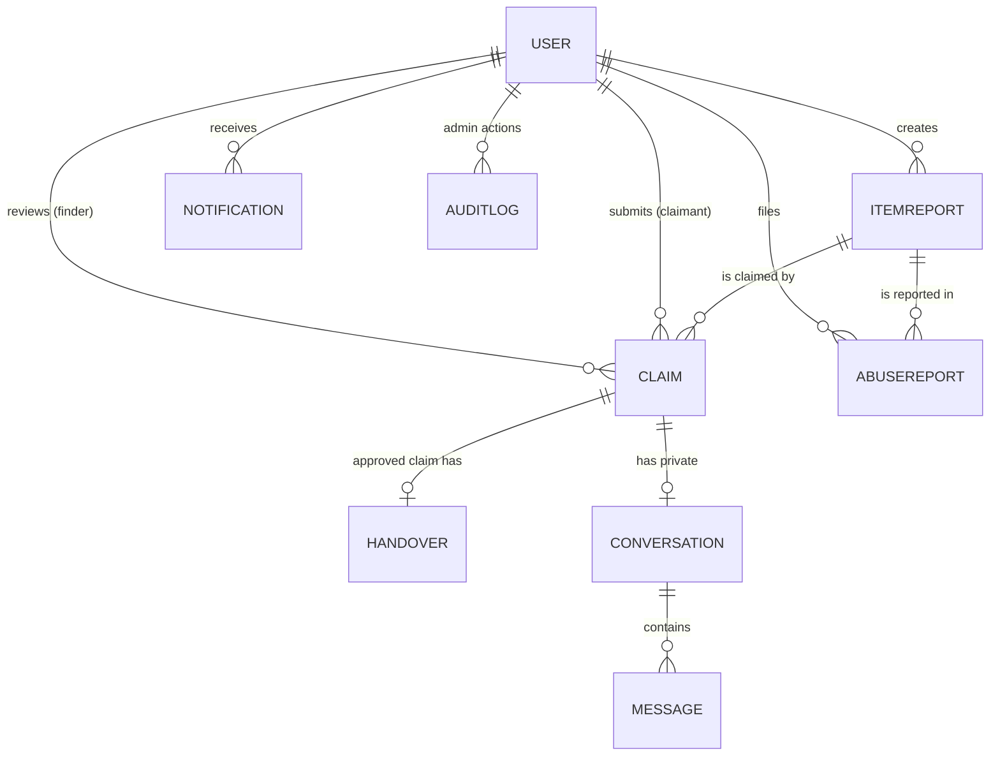

# FindIt: Smart Lost & Found Platform

A full-stack MERN web application that helps students and community members recover lost belongings.
A person reports something lost, another reports something found, FindIt suggests likely matches, the owner proves
the item is theirs, and the two arrange a safe handover. No AI services are used: matching is a simple, documented formula.

> **Honesty note.** This project was written in an environment with no network access and no MongoDB, so the automated tests,
> the production build and a live run have **not** been executed by the author of this code. What was checked is listed in
> [PROJECT_STATUS.md](PROJECT_STATUS.md). Run the commands in "Testing" first and fix anything they reveal.

## Contents
1. [Features](#features) 2. [Tech stack](#tech-stack) 3. [Folder structure](#folder-structure) 4. [Architecture](#architecture)
5. [Database relationships](#database-relationships) 6. [Setup](#setup) 7. [Configuration](#configuration)
8. [MongoDB Atlas](#mongodb-atlas) 9. [Cloudinary](#cloudinary-optional-photos) 10. [Admin and demo data](#admin-and-demo-data)
11. [Authentication](#authentication) 12. [Matching formula](#matching-formula) 13. [API reference](#api-reference)
14. [Testing](#testing) 15. [Production build and deployment](#production-build-and-deployment)
16. [Troubleshooting](#troubleshooting) 17. [Security](#security-considerations) 18. [Limitations and future work](#limitations-and-future-work)

## Features
- **Accounts:** register, log in, log out, session restore after refresh, profile. Two roles only: `USER` and `ADMIN`.
- **Reports:** lost and found reports with category, date, general location, optional photo, contact preference; browse with keyword, type,
  category, location, date range and status filters, pagination and newest-first sorting; edit and withdraw your own.
- **Matching:** explainable rule-based suggestions with a per-part score breakdown. A score is never proof of ownership.
- **Claims:** claimants answer the finder's private verification questions; the finder approves or rejects. Expected answers are never shown to claimants.
- **Handover:** schedule a meeting at a general public place, finder records the handover, claimant confirms receipt (only then is the report RETURNED),
  either side can raise a dispute or cancel.
- **Messaging and notifications:** private conversation per claim, live over Socket.IO with an honest polling fallback, stored notifications.
- **Admin:** database-backed dashboard, report moderation, user suspension, abuse reports, dispute resolution, append-only audit log.
- **UI:** responsive, accessible forms, skeleton loading, empty and error states, toasts, confirmation dialogs, safety guidelines page.

## Tech stack
| Area | Technology |
|---|---|
| Frontend | React 18, Vite, React Router, Tailwind CSS, Axios, Lucide icons, React Hook Form, Zod, Socket.IO client |
| Backend | Node.js, Express, MongoDB with Mongoose, JWT in HTTP-only cookies, bcryptjs, Socket.IO, Multer, Cloudinary, Helmet, CORS, express-rate-limit, Zod |
| Tests | Vitest, React Testing Library (client); Vitest, Supertest, mongodb-memory-server, socket.io-client (server) |

## Folder structure
```
findit/
  client/                    React app (Vite)
    src/api/                 Axios wrappers, one file per backend area (CSRF handled in client.js)
    src/components/          Shared UI (forms, dialogs, badges, pagination, image picker)
    src/context/             Auth, Toast and Realtime (Socket.IO) providers
    src/hooks/ layouts/ pages/ routes/ utils/
    tests/                   Vitest + React Testing Library
  server/
    src/config/              env validation, database connection
    src/models/              Mongoose models
    src/controllers/ routes/ validators/ middleware/ services/ utils/
    src/socket.js            Socket.IO server (authenticated, origin-checked)
    scripts/                 create-admin.js, seed-dev.js
    tests/                   Vitest + Supertest
  render.yaml                Single-service deployment blueprint
  PROJECT_STATUS.md  TESTING_GUIDE.md
```

## Architecture

Request path: `helmet` -> CORS (one explicit origin) -> JSON parser -> cookies -> API rate limit -> CSRF check -> route
-> `authenticate` / `requireRole` -> `zod` validation -> controller -> serializer (explicit field whitelist) -> centralized error handler.

## Database relationships

Key rules enforced by indexes: one active claim per user per item (partial unique index), one APPROVED claim per item (partial unique index),
one handover per claim, one conversation per claim, one open abuse report per user per item. Text index on report title, description and location.

## Setup
Requirements: Node.js 20 or newer, npm, and a MongoDB database (local or Atlas).

```bash
npm install && npm run install:all      # installs root, server and client dependencies
cp server/.env.example server/.env       # then edit it (see Configuration)
npm run dev                              # API on :5000, client on :5173
```
Open http://localhost:5173. Other root commands: `npm run dev:server`, `npm run dev:client`, `npm test`, `npm run build`, `npm start`,
`npm run create-admin`, `npm run seed`.

## Configuration
Copy `server/.env.example` to `server/.env`. The server validates it at startup and names any missing variable (never its value).

| Variable | Required | Notes |
|---|---|---|
| `MONGODB_URI` | yes | Local `mongodb://127.0.0.1:27017/findit` or an Atlas string |
| `JWT_SECRET` | yes | At least 32 random characters. `node -e "console.log(require('crypto').randomBytes(48).toString('hex'))"` |
| `CLIENT_URL` | yes | Exact frontend origin, no trailing slash. Used for CORS and the Socket.IO origin check |
| `PORT`, `NODE_ENV` | no | Defaults 5000 and development |
| `COOKIE_SAMESITE` | no | `lax` (default), `strict` or `none` (HTTPS only; see Authentication) |
| `COOKIE_DOMAIN` | no | e.g. `.example.com` to share the cookie between subdomains |
| `BCRYPT_ROUNDS` | no | Default 12 |
| `AUTH_RATE_LIMIT_MAX`, `MESSAGE_RATE_LIMIT_MAX`, `API_RATE_LIMIT_MAX` | no | Defaults 10 per 15 min (login/register), 30 per minute (messages), 600 per 15 min (whole API) |
| `SERVE_CLIENT` | no | `true` makes the server also serve `client/dist` (single-origin deployment) |
| `CLOUDINARY_CLOUD_NAME`, `CLOUDINARY_API_KEY`, `CLOUDINARY_API_SECRET` | no | Set all three or none |

Client variables (`client/.env.example`) are only for split deployments: `VITE_API_URL`, `VITE_SOCKET_URL`.

## MongoDB Atlas
1. Create a free cluster at https://www.mongodb.com/atlas.
2. **Database Access:** add a database user with a strong password (read and write to any database is enough for this project).
3. **Network Access:** add your current IP address for local development. For a hosted server add its outbound IPs, or `0.0.0.0/0` for a student project (understand the trade-off).
4. **Connect > Drivers:** copy the `mongodb+srv://...` string, put the database name before the `?` (for example `.../findit?retryWrites=true&w=majority`),
   URL-encode special characters in the password, and set it as `MONGODB_URI`.

## Cloudinary (optional photos)
Photo upload is optional. Without Cloudinary the app works fully; the photo field is simply hidden, and the upload endpoint answers `503 Photo upload is not configured`.
1. Create a free account at https://cloudinary.com. 2. Copy the **Cloud name**, **API key** and **API secret** from the dashboard.
3. Put them in `CLOUDINARY_CLOUD_NAME`, `CLOUDINARY_API_KEY`, `CLOUDINARY_API_SECRET`.

The server accepts JPEG, PNG or WebP up to 3 MB, checks the real file bytes (not just the declared type), never writes to disk or uses client file names,
stores images in the `findit/items` folder resized to at most 1200 px, and stores only the returned URL and id. `imageUrl` cannot be set through any normal create or edit request.
**This integration has been tested only against a mock; try it with real credentials before relying on it.**

## Admin and demo data
Public registration always creates a `USER`. Create the first administrator from the server machine:
```bash
cd server
ADMIN_EMAIL=you@example.com ADMIN_NAME="Your Name" npm run create-admin
```
It prompts for the password (hidden) or reads `ADMIN_PASSWORD`. An existing account with that email is promoted and keeps its password.

For a populated demo, `npm run seed` (from the root or `/server`) creates **development data only**: four demo accounts (one admin) and eight sample reports including a matching lost/found pair.
All use the password `Demo@12345` (override with `DEMO_PASSWORD`). It refuses to run when `NODE_ENV=production` and is safe to run twice.

## Authentication
- A JWT lives in an **HTTP-only cookie** (`findit_token`, 7 days). It is never in `localStorage` and the browser's JavaScript cannot read it. Passwords are stored only as bcrypt hashes.
- **CSRF:** double-submit token. The client calls `GET /api/v1/auth/csrf`, keeps the token in memory, and sends it as `X-CSRF-Token` on every POST, PATCH and DELETE; the server compares it with an HTTP-only cookie. A stale token is refreshed and the request retried once.
- **Sessions are re-checked on every request**, so suspending an account or changing a role takes effect immediately.
- **Local development:** keep `COOKIE_SAMESITE=lax`. Vite proxies `/api` and `/socket.io` to Express, so everything is same-origin.
- **Deployment:** the simplest and safest setup is one origin (`SERVE_CLIENT=true`). If the frontend and API are on different sites you need `COOKIE_SAMESITE=none` over HTTPS, and browsers that block third-party cookies will break login. Put both under one parent domain and set `COOKIE_DOMAIN`, or use a reverse proxy.
- Login and registration are rate limited; wrong-password and unknown-email responses are identical.

## Matching formula
`score = 0.35 * category + 0.35 * keywords + 0.15 * date + 0.15 * location`, each part between 0 and 1.

| Part | Definition |
|---|---|
| category | 1 if equal, else 0 |
| keywords | Dice coefficient of the title+description word sets: `2 * shared / (sizeA + sizeB)`. Lower-cased, stop words removed, trailing plural "s" stripped |
| date | 1 on the same day, falling linearly to 0 at 14 days apart. A found date more than 1 day before the lost date scores 0 |
| location | 1 if one location contains the other, else the Dice coefficient of their words |

Suggestions need a score of at least 0.4, show the top 10, consider only ACTIVE reports of the opposite type from other users (never returned, closed, withdrawn or hidden ones),
expose public fields only, and **never approve or create a claim**.

## API reference
Base path `/api/v1`. Responses are `{ success, data, pagination? }` or `{ success: false, message, details?, code? }`. Unsafe methods need `X-CSRF-Token`.
"Optional" auth means signed-in users get extra fields (for example `isOwner`).

**Auth and users**
| Method | Path | Auth | Notes |
|---|---|---|---|
| GET | `/health` | none | 200 when MongoDB is connected, else 503 |
| GET | `/config` | none | `{ uploadsEnabled }` |
| GET | `/auth/csrf` | none | Returns and sets the CSRF token |
| POST | `/auth/register` | none | Always creates a USER. Rate limited |
| POST | `/auth/login` | none | Rate limited |
| POST | `/auth/logout` | none | |
| GET | `/auth/me` | yes | |
| GET, PATCH | `/users/me` | yes | PATCH accepts `name` and `phone` only |

**Reports**
| Method | Path | Auth | Notes |
|---|---|---|---|
| GET | `/items` | optional | `q`, `type`, `category`, `location`, `from`, `to`, `status` (ACTIVE, RETURNED, CLOSED), `page`, `limit` (max 50). Never returns private fields |
| GET | `/items/mine` | yes | My reports, any status |
| GET | `/items/:id` | optional | Owner also gets private details and questions; signed-in non-owners of an active FOUND item get question text (never answers) |
| POST | `/items` | yes | FOUND needs at least one verification question |
| PATCH | `/items/:id` | owner | Active only. `type`, `status`, `createdBy`, `imageUrl` cannot be changed |
| DELETE | `/items/:id` | owner | Withdraws (soft delete). Blocked while claims are open |
| POST, DELETE | `/items/:id/image` | owner | multipart field `image`; 503 if Cloudinary is not configured |
| GET | `/items/:id/matches` | owner | Rule-based suggestions |
| POST | `/items/:id/abuse` | yes | `{ reason, details }`; once per listing per user |

**Claims and handovers**
| Method | Path | Who | Notes |
|---|---|---|---|
| POST | `/items/:id/claims` | non-owner | `explanation`, `answers[{questionId, answer}]` (all questions), optional `evidence` |
| GET | `/items/:id/claims` | finder or admin | Includes the finder's own expected answers |
| GET | `/claims/me`, `/claims/incoming` | claimant / finder | `status`, `page`, `limit` |
| GET | `/claims/:id` | claimant, finder, admin | Others get 404. Claimant view never has expected answers |
| PATCH | `/claims/:id/decision` | finder or admin | `{ decision: APPROVED or REJECTED, reviewNote }` from PENDING only |
| PATCH | `/claims/:id/withdraw` | claimant | PENDING only |
| POST | `/claims/:id/handover` | finder or claimant | APPROVED claims only |
| GET | `/handovers/me`, `/handovers/:id` | parties (admin: read) | `nextActions` tells the UI what the caller may do |
| PATCH | `/handovers/:id/status` | see below | |

| Handover move | From | Who | Body |
|---|---|---|---|
| SCHEDULED | ARRANGING, SCHEDULED | either | `meetingTime` (future, within 60 days), `meetingPlace`, `note` |
| HANDED_OVER | ARRANGING, SCHEDULED | finder | |
| COMPLETED | HANDED_OVER | claimant | Sets the report to RETURNED |
| DISPUTED | ARRANGING, SCHEDULED, HANDED_OVER | either | `reason` (10 to 500 chars) |
| CANCELLED | ARRANGING, SCHEDULED | either | Releases the claim so the item can be claimed again |

**Messaging and notifications**
| Method | Path | Notes |
|---|---|---|
| GET | `/claims/:id/conversation` | Parties only. Creates the conversation on first use |
| GET | `/conversations` | With per-conversation `unread` and `unreadTotal` |
| GET, POST | `/conversations/:id/messages` | `before`, `limit` for history; POST `{ text }` (1 to 1000). Parties only (admins excluded). Read-only once the claim is rejected or withdrawn |
| GET | `/notifications` | `unread=true`, `page`, `limit`; returns `unreadCount` |
| PATCH | `/notifications/:id/read`, `/notifications/read-all` | Own notifications only |

Socket.IO (`/socket.io`, same cookie, `Origin` must equal `CLIENT_URL`): client events `message:send` `{conversationId, text}` and `conversation:read` `{conversationId}` (both acknowledged,
validated, membership re-checked); server events `message:new` and `notification:new`.

**Admin** (all require a signed-in ADMIN, enforced once on the router)
| Method | Path | Notes |
|---|---|---|
| GET | `/admin/dashboard` | Real counts and per-category breakdown |
| GET | `/admin/users` | `q`, `role`, `status` |
| PATCH | `/admin/users/:id/status` | SUSPENDED needs a reason. Not for yourself or other admins |
| GET | `/admin/reports` | All statuses, `flagged=true`, open complaint counts |
| PATCH | `/admin/reports/:id/moderation` | HIDE (reason required, ACTIVE only) or UNHIDE |
| GET, PATCH | `/admin/abuse-reports`, `/admin/abuse-reports/:id` | RESOLVED or DISMISSED |
| GET | `/admin/disputes` | `state` open, resolved or all |
| PATCH | `/admin/disputes/:id/resolution` | COMPLETE (item returned) or CANCEL (claim released), with a note |
| GET | `/admin/audit-logs` | Read-only; `action`, `page`, `limit` |

Endpoints beyond the original brief: `/config`, `/items/mine`, `/items/:id/image`, `/items/:id/abuse`, `/claims/incoming`, `/claims/:id/withdraw`, `/claims/:id/conversation`,
`/handovers/:id`, `/admin/abuse-reports*`, `/admin/disputes/:id/resolution`.

## Testing
```bash
npm run test:server      # Vitest + Supertest. First run downloads a MongoDB binary for mongodb-memory-server
npm run test:client      # Vitest + React Testing Library
npm test                 # both
npm run build            # production build of the client
```
Server tests use an in-memory MongoDB and never touch your real database. Socket tests open a real WebSocket server on a random local port.
Offline or behind a proxy? Set `MONGOMS_SYSTEM_BINARY` to a local `mongod` path. A guided browser walkthrough is in [TESTING_GUIDE.md](TESTING_GUIDE.md).

## Production build and deployment
`npm run build` creates `client/dist`. With `SERVE_CLIENT=true` and `NODE_ENV=production`, `npm start` serves both the API and the app on one origin.
Nothing here has been deployed or verified; follow it and confirm each step yourself.

**Option A, single service (recommended).** On Render: create a Blueprint from this repo (`render.yaml`), set `MONGODB_URI` (Atlas) and `CLIENT_URL` (the service's public URL, no trailing slash), optionally the three Cloudinary variables, deploy,
then provision an admin with `npm run create-admin` from the Render shell. Any host that runs Node and supports WebSockets works the same way: build command `npm run install:all && npm run build`, start command `npm start`.

**Option B, split frontend and API.** Host `client/dist` on a static host (`client/public/_redirects` for Netlify/Render static and `client/vercel.json` provide the SPA fallback) and the API on a Node host.
Build the client with `VITE_API_URL=https://api.example.com/api/v1` and `VITE_SOCKET_URL=https://api.example.com`; on the API set `CLIENT_URL` to the frontend origin, `NODE_ENV=production`, and either put both on one parent domain with `COOKIE_DOMAIN`, or use `COOKIE_SAMESITE=none` (HTTPS only, and some browsers block third-party cookies).

Checklist: Atlas network access allows the host; strong `JWT_SECRET`; `CLIENT_URL` exact; HTTPS in front; WebSockets enabled; admin created; seed data **not** run.

## Troubleshooting
| Symptom | Likely cause and fix |
|---|---|
| Server exits with "Missing required environment variables" | Fill the named variables in `server/.env` |
| "MongoDB connection failed" / health shows 503 | Wrong `MONGODB_URI`, Atlas IP not allowed, or special characters in the password not URL-encoded |
| Login works but you are logged out on refresh, or requests return 401 in production | Cookie not sent: frontend and API on different sites without `COOKIE_SAMESITE=none` + HTTPS, wrong `CLIENT_URL`, or `VITE_API_URL` missing |
| 403 "Invalid or missing CSRF token" | The CSRF cookie was blocked (same cookie problem as above) or a custom client is not sending `X-CSRF-Token` |
| CORS error in the browser | `CLIENT_URL` does not exactly equal the page origin (scheme, host, port, no trailing slash) |
| Chat says "Live updates are unavailable" | WebSocket blocked by the host or proxy, wrong `VITE_SOCKET_URL`, or origin mismatch. Messages still send over REST |
| 429 "Too many attempts" | Rate limit hit; wait, or raise `AUTH_RATE_LIMIT_MAX` in development |
| Photo field missing | Cloudinary variables not set (by design) |
| Server tests hang on first run | mongodb-memory-server is downloading a binary; see Testing |
| Port 5000 busy (macOS AirPlay) | Set `PORT` and update the Vite proxy target in `client/vite.config.js` |

## Security considerations
- Authorization is enforced on the server for every protected operation; hiding a button is never relied on. Admin routes share one router-level guard.
- Public output is built field by field from whitelists, so private details, expected answers and storage ids cannot leak through a new model field. Strangers get 404 (not 403) for private resources.
- All input is validated with Zod, unknown fields are dropped (mass assignment), statuses only change through checked transitions with conditional atomic updates, and regex input is escaped.
- Cookies are HTTP-only, `Secure` in production; CSRF double-submit on every unsafe request; Helmet with a CSP; credentialed CORS for one origin; WebSocket `Origin` check; rate limits on login, messaging and the whole API.
- Messages are stored as typed and rendered as plain text; uploads are type, size and magic-byte checked and held in memory only.
- Admin actions, and admin reads of private claim data, are written to an append-only audit log. Administrators cannot read private conversations.
- No secrets are committed; `.env` is git-ignored. Rotate `JWT_SECRET` to sign everyone out.
- Ownership verification cannot guarantee proof. The UI and [safety page](client/src/pages/Safety.jsx) tell finders to use several pieces of evidence and meet in public.

## Limitations and future work
- Not yet verified by running (see PROJECT_STATUS.md); Cloudinary tested only with a mock; no end-to-end browser tests.
- No email or SMS notifications, password reset, email verification, or two-factor login.
- Matching is intentionally simple (no synonyms or image similarity) and scans the 200 newest candidates.
- Without MongoDB transactions, a crash between two writes could leave an inconsistent state (for example a completed handover whose report is still ACTIVE). Switching to transactions on a replica set (Atlas) would close that gap.
- Ideas: push notifications, report expiry and reminders, multiple photos, admin tools to repair inconsistent states, localisation, an accessibility audit, Playwright end-to-end tests.
